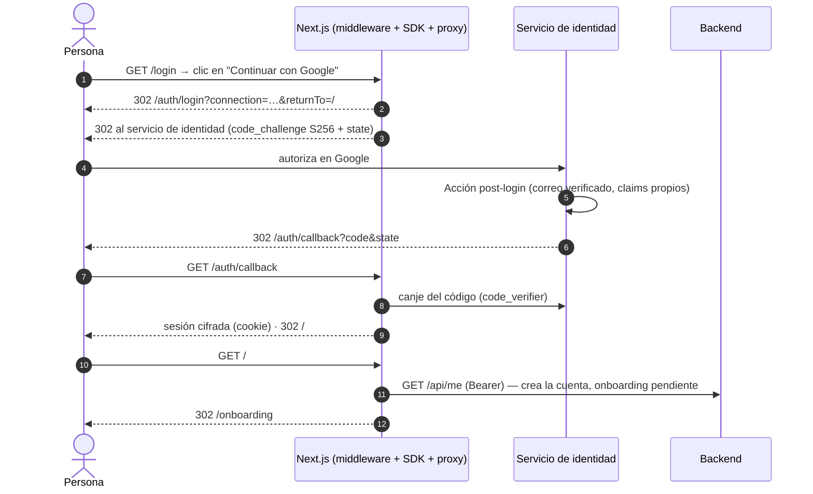
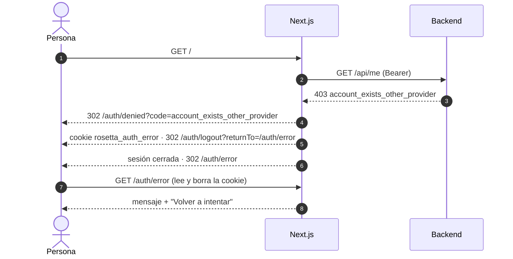
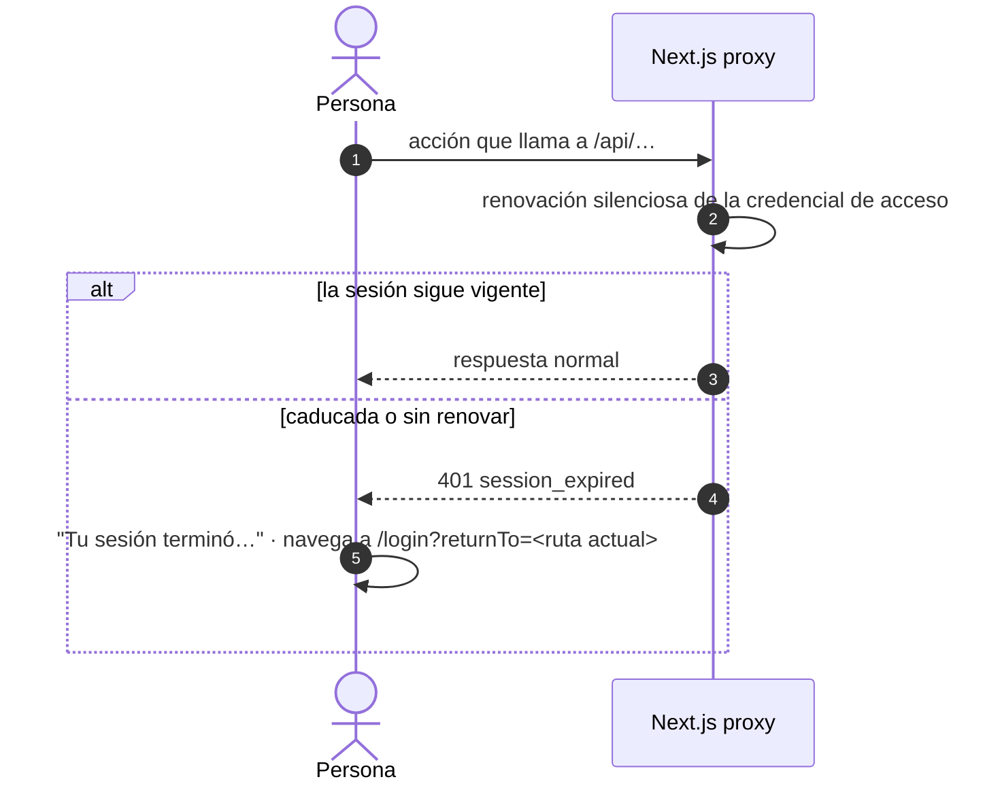

# Contrato: flujo de acceso (rutas, sesión, errores y claims)

**Feature**: [spec.md](../spec.md) · **Plan**: [plan.md](../plan.md) · **Decisiones**: [research.md](../research.md) · **Marco**: [07-seguridad-y-autenticacion.md](../../../docs/03-arquitectura/07-seguridad-y-autenticacion.md), [ADR-0007](../../../docs/03-arquitectura/adr/ADR-0007-autenticacion-auth0.md)

Los valores marcados **provisional** dependen de una decisión pendiente (DP) y pueden cambiar sin afectar a la estructura.

## 1. Pantallas y rutas de Rosetta

| Ruta | Pública | Qué muestra | Requisitos |
|---|---|---|---|
| `/login` | Sí | Pantalla de acceso: "Continuar con Google", "Continuar con Microsoft" y nota de privacidad. Con sesión abierta redirige a `/`. Si llega `notice=session_expired`, muestra encima el aviso de sesión vencida (FR-026) | FR-001, FR-002, FR-026, FR-040 |
| `/auth/error?code=<código>` | Sí | Pantalla de error de acceso: mensaje por código y "Volver a intentar" (a `/login`, conservando `returnTo` si es un destino interno) | FR-036…FR-039 |
| `/auth/denied?code=<código>` | Sí | Sin pantalla: guarda el código en una cookie efímera, cierra la sesión del SDK y redirige a `/auth/error` (§5) | FR-009, FR-011, FR-039 |
| `/` | No | Resuelve el destino: onboarding pendiente → `/onboarding`; si no → `/projects` | FR-014, FR-018 |
| `/onboarding` | No | Bienvenida con el nombre y el paso único: crear el primer proyecto | FR-017…FR-021 |
| `/projects` | No | Lista de proyectos (feature 003) | — |

Cada botón de `/login` navega a `/auth/login?connection=<conexión>&returnTo=<ruta>`: `google-oauth2` para Google y la conexión social de Microsoft para cuentas personales. `returnTo` solo se reenvía si es una ruta interna.

## 2. Rutas que monta el SDK (no se implementan)

| Ruta | Función |
|---|---|
| `/auth/login` | Inicia el acceso (PKCE `S256` y `state` los pone el SDK, FR-027) |
| `/auth/callback` | Recibe el código, valida, crea la sesión cifrada y redirige. Aquí actúa `onCallback` |
| `/auth/logout` | Cierra la sesión de Rosetta y la del servicio de identidad (FR-025); no cierra la de Google ni la de Microsoft |

## 3. Reglas del middleware

`src/middleware.ts` ejecuta primero el middleware del SDK y después estas reglas, y siempre añade la CSP con nonce a la respuesta.

| Petición | Resultado |
|---|---|
| Sin sesión a una ruta privada | 302 a `/login?returnTo=<ruta pedida>` (FR-014) |
| Con sesión a `/login` | 302 a `/` |
| `/login`, `/auth/*`, `/api/*`, `_next/*`, `favicon.ico` | Pasan (las rutas de `/api/*` aplican su propia regla, ver [bff-proxy.md](bff-proxy.md)) |
| `returnTo` externo o con esquema | Se ignora; se usa el destino por defecto (FR-015) |

## 4. Sesión y cookies

| Elemento | Valor |
|---|---|
| Cookie de sesión | `__session`, cifrada con `AUTH0_SECRET`; `HttpOnly` siempre; `SameSite=Lax`; `Secure` activo salvo en desarrollo local (FR-030) |
| Vigencia deslizante | 14 días sin uso — **provisional (DP-022)** |
| Vigencia máxima | 30 días desde el inicio — **provisional (DP-022)** |
| Credencial de acceso | 15 minutos como máximo; solo existe en el servidor de Next.js (FR-023) |
| Renovación | Silenciosa, la hace el SDK al pedir la credencial; el refresh token rota con detección de reutilización en el tenant (FR-023) |
| Cookie de transacción de acceso | `__txn_<state>`; caduca a los 600 s (una solicitud de acceso iniciada vale 10 minutos) |
| Cookie efímera de rechazo | `rosetta_auth_error`: solo contiene un código de la lista de §5; 60 s; `HttpOnly`; `SameSite=Lax`; `Secure` en producción; se borra al leerla |

## 5. Códigos de error de acceso

Códigos que entiende `/auth/error`. Los textos viven en `features/auth/copy.ts`; los definitivos dependen de [DP-025](../../../docs/07-registro/02-decisiones-pendientes.md#dp-025).

| Código | Origen | Cuándo | Camino | Texto |
|---|---|---|---|---|
| `oauth_denied` | Proveedor | La persona cancela el consentimiento | `onCallback` → `/auth/error` (FR-036) | "Cancelaste el inicio de sesión con {proveedor}…" (ya definido en `04-contenido`) |
| `oauth_failed` | Proveedor o SDK | El proveedor no responde o la respuesta es inválida; cualquier fallo no clasificado | `onCallback` → `/auth/error` (FR-037) | "{proveedor} no respondió…" (ya definido); el fallo inesperado usa el error genérico (FR-038) |
| `email_not_verified` | Acción post-login | El proveedor no declara verificado el correo (FR-004) | `onCallback` → `/auth/error` | `[PENDIENTE: DP-025]` · **código provisional** |
| `email_missing` | Acción post-login o backend | No hay correo en la identidad | `onCallback` o `/auth/denied` | `[PENDIENTE: DP-025]` · **código provisional** |
| `account_exists_other_provider` | Backend (403) | El correo ya pertenece a una cuenta de otro proveedor (FR-009) | `/auth/denied` → cierre de sesión → `/auth/error` | `[PENDIENTE: DP-025]` |
| `account_disabled` | Backend (403) | La cuenta está desactivada (FR-011) | `/auth/denied` → cierre de sesión → `/auth/error` | `[PENDIENTE: DP-025]` · **código provisional** |

### Por qué existe `/auth/denied`

Cuando el backend rechaza una cuenta, el SDK ya tiene una sesión válida. Sin cerrarla, la persona volvería a `/login`, este la llevaría a `/`, el backend la rechazaría otra vez y se formaría un bucle (FR-039). `/auth/denied`:

1. Valida `code` contra la lista de §5; cualquier otro valor se trata como `oauth_failed`.
2. Guarda el código en la cookie efímera `rosetta_auth_error`.
3. Redirige a `/auth/logout?returnTo=/auth/error`.
4. `/auth/error` toma el código de la cookie (y la borra) o, si no hay cookie, de la cadena de consulta.

La lista blanca de cierre de sesión del tenant queda con **exactamente** dos destinos: `{APP_BASE_URL}/login` y `{APP_BASE_URL}/auth/error`.

## 6. Claims del access token que el backend espera

El token lo emite el tenant para la audiencia de Rosetta API; la Acción post-login añade los claims propios con espacio de nombres (el tenant de desarrollo ya los tiene, [08-infraestructura §4](../../../docs/03-arquitectura/08-infraestructura-y-entornos.md)).

| Claim | Obligatorio | Uso |
|---|---|---|
| `iss` | Sí | Debe ser el emisor del tenant (FR-029) |
| `aud` | Sí | Debe incluir la audiencia de Rosetta API (FR-029) |
| `exp`, `iat` | Sí | Vigencia; tolerancia de reloj de 10 s |
| `sub` | Sí | Identidad: `auth0_sub` |
| `https://rosetta/email` | Para crear la cuenta | Correo verificado. Sin él, 403 `email_missing` en un alta |
| `https://rosetta/name` | Para crear la cuenta | Nombre. Si falta: **`[PENDIENTE: DP-023]`** |
| `https://rosetta/picture` | No | Avatar |

Cabecera del token: `alg` debe ser `RS256` y `kid` debe estar presente (FR-029).

## 7. Acción post-login del tenant (contrato)

- **Deniega** el acceso si el correo no está verificado (motivo `email_not_verified`) o no existe (`email_missing`) (FR-004).
- **Añade** al access token los tres claims de §6.
- No consulta ni llama a Rosetta: no depende de la disponibilidad del backend.
- Es parte de la lista de comprobación de configuración que se anexa al acta (FR-035): ver [quickstart.md §3](../quickstart.md).

## 8. Variables de entorno

Nombres según [08-infraestructura §4](../../../docs/03-arquitectura/08-infraestructura-y-entornos.md). Los secretos solo en el entorno, nunca en el repositorio (FR-032).

| Variable | Servicio | Secreto | Nota |
|---|---|---|---|
| `AUTH0_DOMAIN` | frontend, backend | No | |
| `AUTH0_AUDIENCE` | frontend, backend | No | Identificador de Rosetta API |
| `AUTH0_CLIENT_ID` | frontend | No | |
| `AUTH0_CLIENT_SECRET` | frontend | **Sí** | |
| `AUTH0_SECRET` | frontend | **Sí** | Cifra la cookie de sesión; 32 bytes en hexadecimal |
| `APP_BASE_URL` | frontend | No | Origen de Rosetta; base de la lista blanca |
| `BACKEND_INTERNAL_URL` | frontend | No | Destino del proxy |
| `AUTH0_ISSUER`, `AUTH0_JWKS_URL` | backend | No | **Solo pruebas y E2E**: sobreescriben el emisor y las claves. Producción exige `https` y una prueba lo verifica |
| `E2E_ALLOW_INSECURE_IDP` | frontend | No | **Solo E2E**: activa `allowInsecureRequests`; el SDK lo ignora si `NODE_ENV=production` |

## 9. Secuencias

### Primer acceso con una cuenta nueva

### Cuenta rechazada después de autenticarse

### Sesión vencida durante el trabajo

