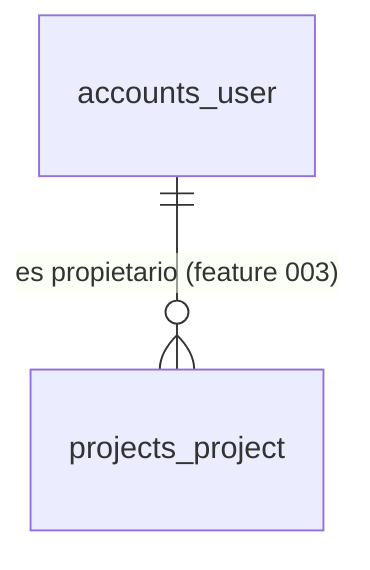
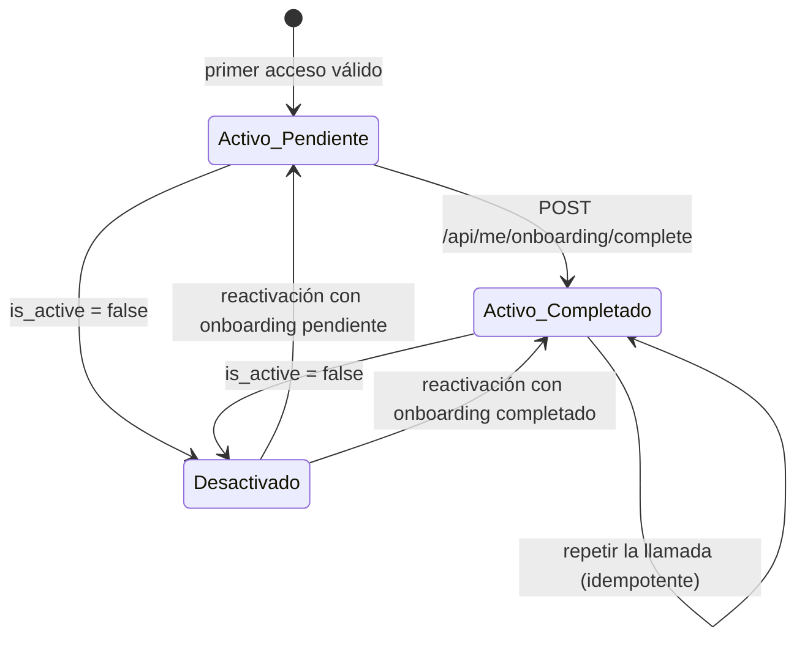

# Data Model: Inicio de sesión con Google y Microsoft

**Feature**: [spec.md](spec.md) · **Plan**: [plan.md](plan.md) · **Fuente de verdad del esquema**: [02-diccionario-de-datos.md](../../docs/04-datos/02-diccionario-de-datos.md) (`accounts_user`). Este documento no cambia el esquema documentado: lo concreta para la implementación. Si difieren, gana `docs/`.

## Entidades persistidas

Esta feature persiste **una sola tabla**. La sesión no se guarda en Rosetta (la lleva una cookie cifrada del frontend, ADR-0007) y el onboarding es un campo del usuario.

### `accounts_user` · Usuario

Origen: Key Entities *Usuario* de la spec · ROS-89, ROS-90, ROS-91, ROS-180, ROS-185.

| Campo | Tipo | Nulo | Por defecto | Regla / origen |
|---|---|---|---|---|
| `id` | UUID | No | `uuid4` | Clave primaria; los identificadores nunca son predecibles (RNF-04) |
| `auth0_sub` | texto (≤ 255) | No | — | Identidad asegurada por el proveedor, **única** y estable. Es el campo de identificación (`USERNAME_FIELD`) y la forma de reconocer la cuenta (FR-006) |
| `email` | texto (≤ 254) | No | — | Correo verificado. **Único sin distinguir mayúsculas** (FR-008). Se guarda tal como llega; la unicidad compara en minúsculas |
| `full_name` | texto (≤ 200) | No | — | Nombre que entrega el proveedor, truncado a 200. Si el proveedor no lo entrega: la parte local del correo, lo que va antes de `@` ([DP-023](../../docs/07-registro/02-decisiones-pendientes.md#dp-023)) |
| `avatar_url` | texto (≤ 500) | Sí | nulo | Solo `http(s)`; si supera 500 caracteres o no es `http(s)` se guarda nulo (R-03) |
| `is_active` | booleano | No | `true` | `false` = desactivada: no puede entrar ni usar una sesión abierta (FR-011). No se borran usuarios con acciones auditadas |
| `is_staff` | booleano | No | `false` | Reservado para soporte interno; **sin uso** en el MVP ([DP-024](../../docs/07-registro/02-decisiones-pendientes.md#dp-024), opción A decidida en CD-012) |
| `onboarding_completed_at` | fecha y hora UTC | Sí | nulo | `nulo` = onboarding **pendiente**; con valor = completado (FR-017, FR-021) |
| `last_login_at` | fecha y hora UTC | Sí | nulo | Última petición autenticada; se actualiza como máximo una vez por hora |
| `created_at`, `updated_at` | fecha y hora UTC | No | ahora | Marcas de tiempo estándar |
| `password` | texto | No | inutilizable | Heredado de la clase base. **Siempre** inutilizable: no hay contraseñas (FR-001) |

El campo `last_login` de la clase base se descarta (`last_login = None`); la fecha propia es `last_login_at`. Tabla: `accounts_user`. Orden por defecto explícito: `created_at`.

### Índices y restricciones

| Restricción | Tipo | Protege |
|---|---|---|
| `auth0_sub` único | Única | Reconocer a la misma persona sin duplicarla, también con accesos simultáneos (FR-005, SC-002) |
| `lower(email)` único | Única funcional | Un correo = una cuenta, sin importar mayúsculas (FR-008, FR-009) |
| `auth0_sub` y `email` no vacíos | Comprobación | Un usuario nunca queda sin identidad ni correo |

No hay claves foráneas **desde** esta tabla. Hacia ella apuntan `projects_project.owner_id` (feature 003) y las demás tablas con autoría; son `PROTECT` (no se borra un usuario con acciones auditadas, se desactiva).

## Relaciones

El "espacio personal" de FR-017 no es una entidad: es el usuario con una lista vacía de proyectos.

## Transiciones de estado

- El onboarding **solo avanza** (`pendiente → completado`); no hay operación que lo devuelva a pendiente.
- En el MVP **no existe** ninguna operación para desactivar o reactivar un usuario (no hay consola, [DP-024](../../docs/07-registro/02-decisiones-pendientes.md#dp-024)); el estado existe para que `PROTECT` y FR-011 tengan sentido.

## Reglas de validación y de alta

| Regla | Detalle | FR |
|---|---|---|
| Alta en el primer acceso | Se crea con contraseña inutilizable, `is_active = true`, `is_staff = false` y onboarding pendiente | FR-005, FR-017 |
| Correo ya registrado con otro proveedor | Si no existe el `auth0_sub` pero sí `lower(email)`: se rechaza (403 `account_exists_other_provider`); no se crea nada | FR-009 |
| Actualización | Nombre y avatar se actualizan si cambiaron. El correo también, **salvo que el nuevo choque con otro usuario**: entonces se conserva el anterior y se registra un evento sin datos personales | FR-007, FR-010 |
| Acceso simultáneo | La segunda creación falla por la restricción única y se recupera leyendo por `auth0_sub`: una sola fila | FR-005 |
| Cuenta desactivada | Se rechaza en cada petición (403 `account_disabled`); sin caché | FR-011 |
| Idempotencia del onboarding | `onboarding_completed_at` solo se escribe si es nulo | FR-021 |

## Origen de los datos: correspondencia con los claims

El backend lee los datos del access token emitido por el tenant; los nombres de los claims propios llevan espacio de nombres y están en [contracts/auth-flow.md §6](contracts/auth-flow.md).

| Campo | Claim |
|---|---|
| `auth0_sub` | `sub` |
| `email` | `https://rosetta/email` |
| `full_name` | `https://rosetta/name` |
| `avatar_url` | `https://rosetta/picture` |

## Lo que esta feature no persiste

- **Sesión, credenciales de acceso y de renovación:** viven en la cookie cifrada del frontend y en el servicio de identidad; Rosetta no las guarda.
- **Eventos de seguridad** (acceso rechazado, choque de correo): van a los registros, sin datos personales, no a la base de datos.
- **Contraseñas:** no existen.

## Migración

- Migración inicial de `accounts` (`0001_initial`) con `AUTH_USER_MODEL = "accounts.User"` fijado **antes** de generarla. No hay migraciones previas que dependan del usuario por defecto: el esqueleto solo tiene `contenttypes` ([research R-04](research.md#r-04--modelo-de-usuario)).
- Fábrica de pruebas con datos sintéticos (RNF-38); ningún dato real en pruebas ni semillas.
