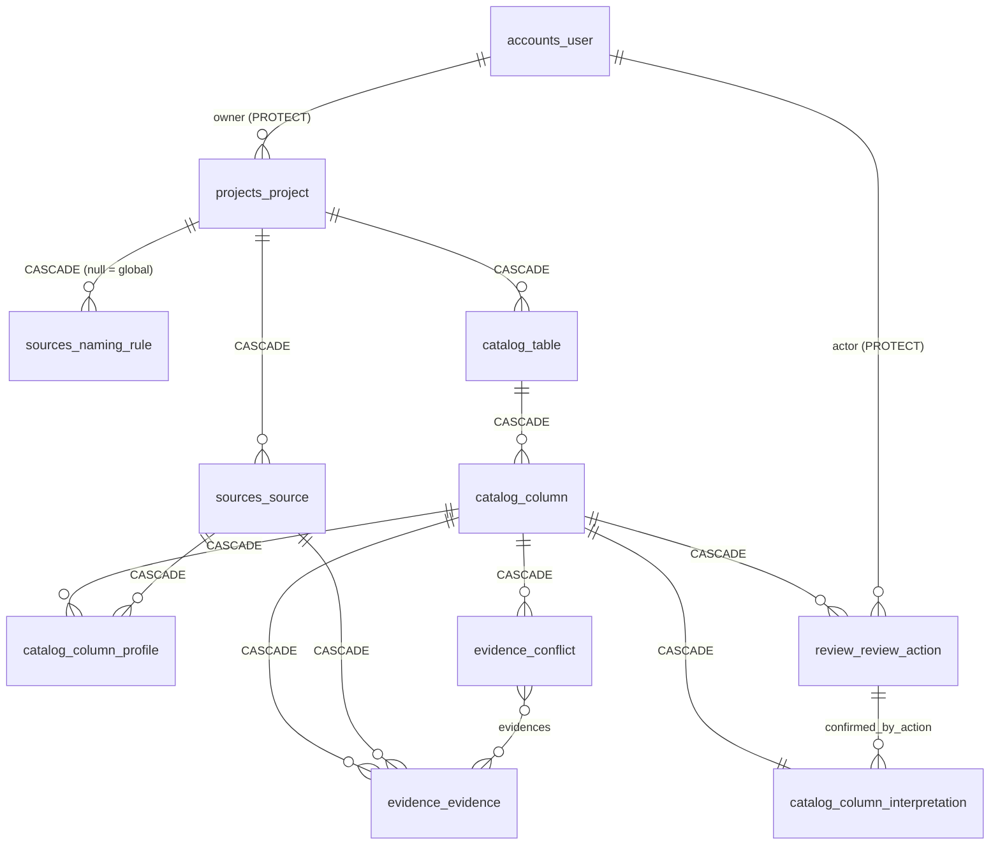

# Data Model: Proyectos y núcleo de datos

**Feature**: [spec.md](spec.md) · **Plan**: [plan.md](plan.md) · **Fuente de verdad**: [02-diccionario-de-datos.md](../../docs/04-datos/02-diccionario-de-datos.md)

Este documento **no redefine** las columnas del diccionario: las implementa tal cual y solo detalla lo que la feature 003 añade o concreta. Lo marcado **(D1)**/**(D2)** es una desviación que CD-013 tiene que llevar al diccionario antes de implementar ([plan, Desviaciones](plan.md#desviaciones-respecto-a-docs-a-resolver-por-cd-013-antes-de-implementar)).

## Convenciones

- `id` UUID v4 generado por la aplicación (`core.UUIDModel`); `created_at`/`updated_at` UTC (`core.TimeStampedModel`), salvo `review_review_action` (sin `updated_at`) y `evidence_evidence` (solo `created_at`).
- Enums como `varchar` con `CHECK` (`TextChoices`). Tablas `<app>_<modelo>`.
- Todo modelo con datos de cliente tiene `objects.for_user(user)` (regla B4).

## Mapa de entidades



## `projects_project` (app `projects`)

| Campo | Regla de esta feature |
|---|---|
| `owner_id` | Persona que crea el proyecto; `PROTECT`. Nunca cambia |
| `organization_id` | Siempre `null` en el MVP |
| `name` | Recortado; 1–120 caracteres (FR-001). Único entre los proyectos **activos** del mismo propietario, sin distinguir mayúsculas **(D2)**: `UniqueConstraint(Lower("name"), "owner", condition=Q(archived_at__isnull=True))` |
| `description` | `""` al crear; editable con `PATCH` |
| `source_dialect` | `tsql` \| `oracle` \| `postgres`, `CHECK`, no nulo; **inmutable** después de crear (FR-010, DP-019) |
| `archived_at` | `null` = activo |
| `last_activity_at` **(D1)** | No nulo; `= created_at` al crear. Lo actualiza `touch_activity()` en la transacción de cada cambio del proyecto o de su contenido (R-07); leer no lo toca |

**Índices:** `(owner_id, last_activity_at desc)` **(D1)** para la lista; el único parcial de D2.

**Estados y transiciones** (FR-012, FR-013):

```mermaid
stateDiagram-v2
    [*] --> Activo: crear (nombre libre entre activos)
    Activo --> Activo: renombrar / cambiar descripción
    Activo --> Archivado: archivar
    Archivado --> Activo: desarchivar (si el nombre choca, renombrar en la misma operación)
    note right of Archivado: solo lectura: toda mutación → 409 project_archived
```

No hay borrado de proyectos en el MVP.

**Valores derivados que expone la API** (no se guardan):
- `table_count` = tablas del proyecto; `column_count` = columnas del proyecto.
- `confirmed_ratio` = columnas con interpretación `CONFIRMED` (directas + propagadas, DP-020) / `column_count`; `null` si `column_count = 0` (la interfaz decide cómo mostrarlo, texto en DP-028).

## Catálogo, fuentes, evidencia y revisión

Se implementan **exactamente** como en el diccionario: `catalog_table`, `catalog_column`, `catalog_column_interpretation` (con el `CHECK` `level = 'CONFIRMED'` ⇔ `confirmed_by_action_id IS NOT NULL`), `catalog_column_profile` (único `(column_id, source_id)`), `sources_source`, `sources_naming_rule` (`weight ≤ 0,40`, único `(coalesce(project_id,'global'), pattern, match_type)`), `evidence_evidence`, `evidence_conflict` + `evidence_conflict_evidences`, `review_review_action`.

Concreciones de esta feature:

| Modelo | Concreción |
|---|---|
| Todos los de cliente | `for_user(user)` filtra por `project__owner=user` (o `project_id` desnormalizado cuando existe) |
| `sources_naming_rule` | `for_user(user)` devuelve las del proyecto del usuario **más** las globales (`project_id is null`); las globales son de solo lectura (`global_rule_readonly`, ya en 05-api) |
| `evidence_evidence` | `save()` rechaza actualizar una fila existente (FR-025): solo crear y borrar |
| `review_review_action` | `save()` rechaza actualizar; `delete()` lanza error; trigger `BEFORE UPDATE OR DELETE` en la migración (FR-023) |
| `catalog_column_interpretation` | La cola (R-09) ordena por `impact desc`, luego por `TABLA.COLUMNA`; índice `(project_id, level, impact desc)` |

## Validaciones (resumen)

| Regla | Dónde | Error |
|---|---|---|
| Nombre vacío o > 120 tras recortar | serializer | `400 validation_error` con `details.name` |
| Nombre repetido entre activos | service + restricción | `400 project_name_taken` con `details.name` |
| Dialecto ausente o fuera de la lista | serializer | `400 validation_error` con `details.source_dialect` |
| `source_dialect` en un `PATCH` | serializer | `400 validation_error` |
| Mutación de un proyecto archivado | `ensure_project_writable()` | `409 project_archived` |
| Recurso ajeno o inexistente | `get_owned_or_404()` | `404 not_found` (cuerpo idéntico) |

## Proyecto de ejemplo (R-12)

`tests/fixtures/core_demo_snapshot.json` (sintético): proyecto `CORE_DEMO` (`tsql`), una fuente `SCHEMA_DDL` en `READY`, `MOV0010` con sus 11 columnas, nombres de negocio y niveles de [03-datos-de-referencia §2](../../docs/04-datos/03-datos-de-referencia.md), las tablas de §3 y tablas extra que repiten `PGCOD`, `CTANRO` y `PETDOC` con el mismo tipo; reglas globales de §6; tres `ReviewAction` `CONFIRM` (SUCCOD, MONCOD, FEALT). `engine_version = "fixture"` en todas las interpretaciones.
